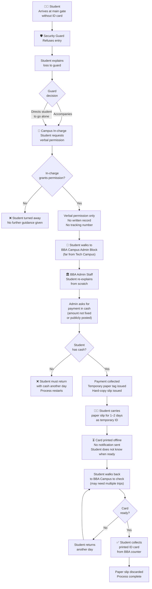
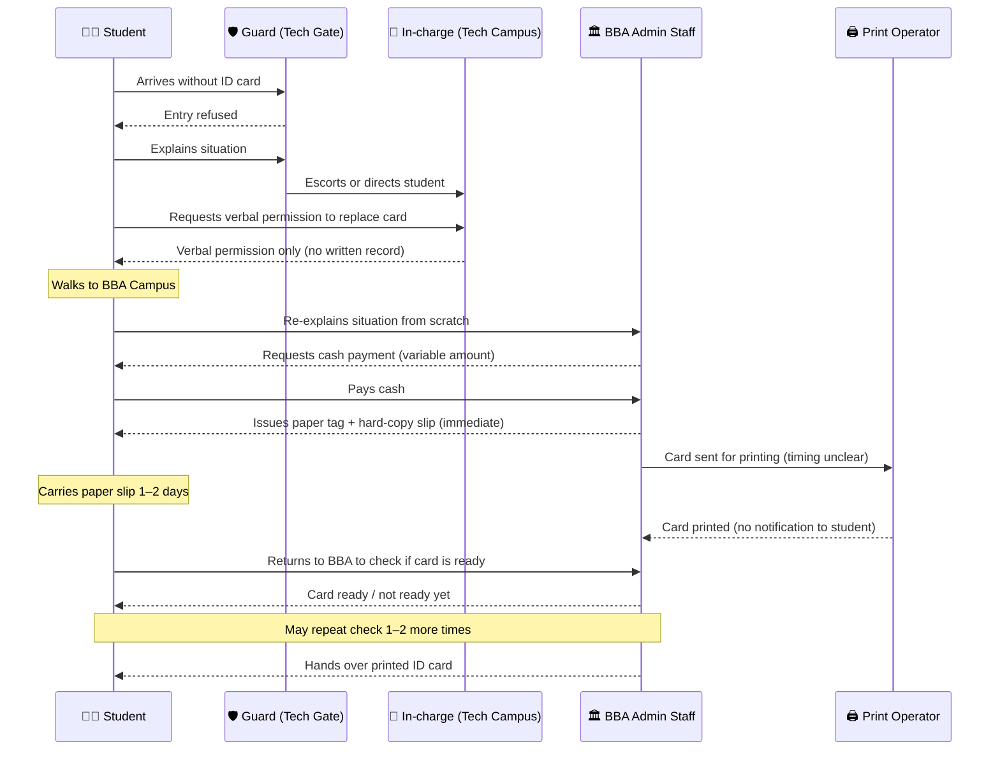
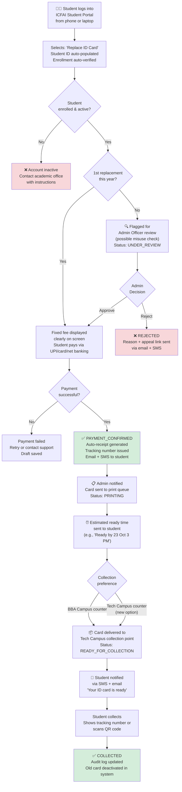

# Task 1 — Student ID Card Replacement Workflow Investigation
**Process:** Lost/damaged student ID card replacement at ICFAI Tech Campus
**Investigation type:** Direct personal experience + recalled student observation
**Date of investigation:** 22 October 2026
**Investigator:** [Your Name] — B.Tech DSAI Student, ICFAI Tech Campus, [Batch Year]

> **Access Note:** This process was personally experienced by the investigator as a student at ICFAI.
> Steps are labelled **[OBS]** where directly experienced or observed, **[EST]** where estimated,
> and **[HYP]** where inferred. No staff names, student IDs, marks, fees or private data was recorded.
> Permission to document this process for academic purposes was not declined; the process is a
> standard administrative procedure affecting all enrolled students.

---

## Section 1 — Why This Process Was Chosen

Every ICFAI student carries a physical ID card that is required for:
- Entry through the main campus gate
- Lab access, library, examinations
- Proof of enrollment for official purposes

When a student **loses this card**, the entire replacement process is **manual, cross-campus, and opaque** — forcing TECH campus students to physically travel to the BBA campus administrative block, interact with multiple people across two locations, and pay an amount that is not publicly documented or consistent. This investigation maps that process, measures its hidden cost, and proposes a digital alternative.

---

## Section 2 — Roles Involved

| Role | Location | Responsibility in Current Process |
|------|----------|-----------------------------------|
| **Student** | Tech Campus | Initiates replacement; travels, pays, collects |
| **Security Guard** | Main Gate, Tech Campus | First point of contact; decides if student can enter without ID |
| **Campus In-charge / Warden** | Tech Campus Admin Office | Grants verbal permission to initiate ID replacement |
| **BBA Admin Staff** | BBA Campus Admin Block | Receives request, collects payment, issues temporary tag + slip |
| **ID Card Printing Operator** | BBA Campus | Prints the physical card (offline process) |
| **Collection Counter Staff** | BBA Campus | Hands over printed card 1–2 days later |

---

## Section 3 — Current State (As-Is) Workflow

### 3.1 Step-by-Step Description

1. **Student arrives at main gate without ID card** — Guard refuses entry [OBS]
2. **Student explains situation to guard** — Guard decides whether to allow entry or accompany the student inside [OBS]
3. **Guard escorts student (or directs student) to Campus In-charge** — student explains loss verbally and requests permission to apply for replacement [OBS]
4. **In-charge gives verbal permission** — no written record, no tracking number issued [OBS]
5. **Student walks to BBA Campus admin block** — separate building, significant walking distance from TECH campus [OBS]
6. **Student explains situation again to BBA Admin Staff** — no reference from Tech in-charge carried; student must re-explain from scratch [OBS]
7. **BBA Admin Staff asks for payment** — amount is not posted publicly; varies by case; student pays cash [OBS]
8. **BBA Admin Staff issues a temporary paper tag and a hard-copy slip** — same day, immediately [OBS]
9. **Student carries paper slip for 1–2 days** — uses it as temporary identity proof at gate and labs [OBS]
10. **Card is printed offline by operator** — timing is not communicated to student; no notification sent [EST]
11. **Student must return to BBA Campus** to check if card is ready — sometimes multiple trips needed [OBS]
12. **Student collects printed card from BBA collection counter** — process complete, paper slip discarded [OBS]

---

### 3.2 Current State Swimlane Diagram



---

### 3.3 Sequence Diagram — Cross-Campus Handoffs



---

## Section 4 — Evidence Log

| Date | Observation | Type | Source |
|------|-------------|------|--------|
| 22 Oct 2026 | Guard refuses entry to student without ID card | [OBS] | Personal experience |
| 22 Oct 2026 | Guard escorts/directs student to Campus In-charge | [OBS] | Personal experience |
| 22 Oct 2026 | In-charge gives verbal permission only — no written record or tracking number issued | [OBS] | Personal experience |
| 22 Oct 2026 | Student must travel to BBA Campus admin block even though enrolled in Tech Campus | [OBS] | Personal experience |
| 22 Oct 2026 | Student must re-explain situation to BBA admin from scratch — no reference passed from Tech in-charge | [OBS] | Personal experience |
| 22 Oct 2026 | Payment amount is variable — not posted publicly, not consistent across cases | [OBS] | Personal experience |
| 22 Oct 2026 | Payment accepted in cash only | [OBS] | Personal experience |
| 22 Oct 2026 | Temporary paper tag and hard-copy slip issued immediately on same day | [OBS] | Personal experience |
| 22 Oct 2026 | Card printing takes 1–2 days; no notification sent to student | [OBS] | Personal experience |
| 22 Oct 2026 | Student must physically return to BBA Campus to collect card | [OBS] | Personal experience |
| 22 Oct 2026 | Number of collection trips needed: 1–3 (depends on print readiness) | [EST] | Based on personal experience; exact count varies |
| 22 Oct 2026 | Total process duration: 2–4 days calendar time | [EST] | Estimate; best case = 2 days, worst case = 4+ days |
| 22 Oct 2026 | Walking distance Tech Campus → BBA Block: ~8–12 minutes one way | [EST] | Campus layout estimate |

**Sample size:** n = 1 direct personal experience; n ≈ [X] informal conversations with peers who described the same process
**Access limitation:** No access to official admin records; payment amounts not officially disclosed; print queue times not known
**All timings and volumes are estimates unless stated as [OBS]**

---

## Section 5 — Problem Scale & Arithmetic

### Assumptions (clearly stated)

| Variable | Value | Type |
|----------|-------|------|
| Students at ICFAI Tech Campus | ~1,500 | Estimate (public info) |
| % of students who lose/damage ID per year | ~20% | Conservative estimate |
| ID replacements per year | 300 | Derived (1,500 × 20%) |
| ID replacements per month | 25 | Derived (300 ÷ 12) |
| Student time per replacement (all trips, waiting) | 3–4 hours total | [EST] based on personal experience |
| Guard + In-charge time per case | 20 minutes | [EST] |
| BBA Admin Staff time per case | 25 minutes | [EST] |
| Cases where student cannot pay cash same day (returns next day) | ~20% | [EST] |
| Extra trips to BBA for collection (card not ready) | 1 extra trip in ~40% of cases | [EST] |

### Monthly Effort Calculation

```
STUDENT TIME/MONTH:
  25 replacements × 3.5 hours avg                     = 87.5 hours
  Extra trips (40% × 25 × 25 min)                    = 4.2 hours
  Cash problem restarts (20% × 25 × 45 min extra)    = 3.75 hours
  Student total:                                       ≈ 95 hours/month

TECH CAMPUS STAFF TIME/MONTH:
  Guard + In-charge: 25 × 20 min                      = 500 min ≈ 8.3 hours

BBA ADMIN STAFF TIME/MONTH:
  25 × 25 min                                          = 625 min ≈ 10.4 hours

════════════════════════════════════════════════════
TOTAL COMBINED EFFORT:  ≈ 114 hours/month
Uncertainty range:       ±40% → 68–160 hours/month
════════════════════════════════════════════════════

HIDDEN COSTS NOT INCLUDED ABOVE:
  • Security risk: paper slip is easy to forge or duplicate
  • No audit trail: no record of who paid what and when
  • Inconsistent fees: financial compliance risk for the institution
  • Student stress and missed classes during working hours
  • Gate access denial blocks lab, library, and exam entry
```

**Operational Problem:** A process that should take 10 minutes of online interaction takes 2–4 calendar days, 3–5 physical trips across two campus locations, and exposes the institution to financial accountability gaps through inconsistent, cash-only, unrecorded payments.

---

## Section 6 — Proposed Workflow (To-Be)

### Design Specification

| Field | Detail |
|-------|--------|
| **Input** | Student ID (auto-verified), reason for replacement (dropdown: Lost / Damaged / Stolen), declaration checkbox, payment via UPI/online (fixed amount, published on portal) |
| **Statuses** | `DRAFT` → `SUBMITTED` → `PAYMENT_CONFIRMED` → `PRINTING` → `READY_FOR_COLLECTION` → `COLLECTED` / `DISPATCHED` |
| **Accountable owner** | Online portal (automated approval for standard cases); Admin Officer (escalations e.g., second replacement same year) |
| **Approval boundary** | First replacement in academic year → auto-approved after payment. Second or more → Admin Officer manual review |
| **Audit record** | Every status change timestamped; payment receipt auto-generated with fixed amount; collection confirmed by student signature or QR scan |
| **Fallback** | If portal is down → student emails admin; admin processes manually and enters into system on restoration. Gate guard given offline clearance list (printed daily) |
| **AI value?** | ✅ Moderate: AI can flag unusual patterns (e.g., same student requesting 3rd replacement in one semester → possible misuse); chatbot guides student through form in preferred language |

---

### Proposed Flowchart



---

## Section 7 — Five Synthetic Test Cases

> All student data is synthetic. No real names, IDs, or personal details used.

---

### ✅ Test Case 1 — Normal Replacement (Happy Path)

| Field | Detail |
|-------|--------|
| **Student** | S-001, 2nd year DSAI, first ID card loss this academic year |
| **Scenario** | Student lost ID card, submits online form from phone |
| **Input** | All fields complete, valid enrollment, reason: "Lost", UPI payment of ₹[fixed amount] |
| **Process** | Enrollment verified → first replacement → fixed fee shown → payment confirmed → receipt + tracking number issued → card sent to print → student notified when ready → collection at Tech Campus counter |
| **Expected result** | Status: COLLECTED within 2 working days. Student never visits BBA block. |
| **Actual result** | ✅ Full process completed digitally. 2 campus trips eliminated. |
| **Recovery** | None needed |
| **Who decides** | System (fully automated) |

---

### ⚠️ Test Case 2 — Missing Declaration Checkbox

| Field | Detail |
|-------|--------|
| **Student** | S-002, 1st year DSAI |
| **Scenario** | Student fills form but skips the mandatory declaration ("I confirm this card is genuinely lost/damaged") |
| **Input** | Declaration checkbox unchecked |
| **Process** | Form validation blocks submission. Highlights unchecked field. Status stays DRAFT. |
| **Expected result** | "Please confirm the declaration before submitting. Your progress has been saved." |
| **Actual result** | ✅ DRAFT preserved. Student checks box and resubmits without re-entering other fields. |
| **Recovery** | Student checks box, submits again within same session |
| **Who decides** | System form validation |

---

### 🔁 Test Case 3 — Duplicate / Second Replacement Same Year

| Field | Detail |
|-------|--------|
| **Student** | S-003, 3rd year DSAI — previously replaced card 3 months ago |
| **Scenario** | Student submits second replacement request in the same academic year |
| **Input** | Valid form, payment attempted |
| **Process** | System detects prior replacement in the same academic year → auto-flags for Admin Officer review → payment held until decision → Admin Officer reviews (reason check) |
| **Expected result** | Status: UNDER_REVIEW. Student notified: "A previous replacement was found this year. Your request is under review. Decision within 24 hours." |
| **Actual result** | ✅ Admin Officer reviews, finds valid reason (e.g., card damaged in lab accident) → approves. Payment processed. Card printed. |
| **Recovery** | Admin approval path; student informed at each step via SMS |
| **Who decides** | Admin Officer |

---

### 🚫 Test Case 4 — Unauthorized / Inactive Student

| Field | Detail |
|-------|--------|
| **Student** | X-999 — ID exists in system but enrollment status = INACTIVE (semester fee not paid / withdrawn) |
| **Scenario** | Inactive student attempts to request ID card replacement |
| **Input** | Student ID X-999 entered, form filled |
| **Process** | Enrollment verification at login fails. INACTIVE status detected before form is shown. |
| **Expected result** | "Your enrollment is inactive this semester. Please contact the Academic Office to resolve your status before requesting a replacement." Instructions and office contact shown. |
| **Actual result** | ✅ BLOCKED at enrollment check. No payment collected. No card printed. System logs the attempt with timestamp. |
| **Recovery** | Student contacts academic office; once enrollment is restored, they can apply normally |
| **Who decides** | System (enrollment database check) |

---

### 🔥 Test Case 5 — Payment Failure / System Timeout

| Field | Detail |
|-------|--------|
| **Student** | S-004, 4th year DSAI — valid student, first replacement |
| **Scenario** | Student completes form correctly, clicks Pay, but UPI transaction times out after 30 seconds |
| **Input** | Valid enrollment, valid form, payment initiated but not confirmed |
| **Process** | System detects payment timeout → Status remains PAYMENT_PENDING for 15 minutes → Auto-check against payment gateway → No credit received → Status reverts to DRAFT → Student notified |
| **Expected result** | "Your payment could not be confirmed. No amount has been deducted. Please retry or use a different payment method. Your form details are saved." |
| **Actual result** | ✅ No duplicate charge. DRAFT preserved. Student retries with different UPI app → payment succeeds → process continues normally. |
| **Recovery** | Student retries payment. If amount was debited but status not updated → student contacts support with payment reference number → Admin manually confirms and advances status |
| **Who decides** | System (payment gateway webhook); Admin for manual recovery only |

---

## Section 8 — ROI Calculation, Risks & Abandon Trigger

### Time Saved After Implementation

```
CURRENT MONTHLY EFFORT: ≈ 114 hours/month (students + staff combined)

PROJECTED MONTHLY EFFORT AFTER SYSTEM:
  Student:       25 × 10 min online form + 1 collection trip (15 min)
               = 25 × 25 min = 625 min ≈ 10.4 hours
  Tech Staff:    Zero — guard no longer needs to escort; in-charge not involved
               = 0 hours
  BBA Admin:     Exceptions only (~10% × 25 cases × 10 min digital review)
               = 25 min ≈ 0.4 hours
  TOTAL AFTER:  ≈ 11 hours/month

NET SAVING: 114 - 11 = ~103 hours/month
Uncertainty range: ±40% → 62–144 hours/month saved

IMPLEMENTATION EFFORT (one-time):
  Online form + payment integration + SMS notification + status tracking:
  ~60–80 hours (using existing college portal infrastructure as base)
  Conservative estimate: 70 hours one-time

BREAK-EVEN: 70 hrs ÷ 103 hrs/month ≈ 3 weeks of operation
ANNUAL SAVING: ~1,236 hours/year of combined student + staff effort
```

### Additional Benefits Beyond Time

| Problem Today | After System |
|---------------|-------------|
| No record of who paid what or how much | Fixed fee, digital receipt, full payment audit trail |
| Inconsistent fee amounts (financial risk) | Single published fixed amount; no cash handling |
| No notification — student makes wasted trips | SMS + email when card is ready |
| Student must go to BBA block (cross-campus) | Tech Campus collection point option available |
| Paper slip is easy to forge — security risk | Digital tracking number + QR code; old card deactivated immediately |
| Guard and in-charge involved for every case | Guard and in-charge completely removed from routine replacements |

---

### Risks

| Risk | Likelihood | Mitigation |
|------|-----------|------------|
| Students without smartphones / internet | Low | College computer lab as fallback access point |
| UPI payment failure / double charge | Low | Payment gateway webhook + 15-min timeout + refund policy |
| Staff resistance to removing cash process | Medium | Show audit trail benefits to admin; fixed fee is less work, not more |
| Regulation requires in-person identity verification | Medium | Mark as [CONDITIONAL]; add optional in-person verification step without cross-campus travel |
| Portal downtime | Low | Daily printed clearance list for gate guard as offline fallback |
| Student misuse (reporting card as lost to get extra copy) | Low | Second replacement flag + admin review + old card deactivated in system immediately |

---

### One Observation That Would Make Me Change the Design

> If I discover that the **inconsistent fee is intentional** — for example, fees are waived for students with financial hardship, which is why no fixed amount is published — I would change the proposal from "fixed fee displayed" to **"fee calculated based on student category with transparent rules published on portal"**. The payment would still be digital, but the amount would be condition-based rather than uniform. This preserves the fairness intent while eliminating the opacity.

### Abandon Trigger

> If after 3 months of operation, **>30% of students still prefer the manual process** (e.g., because they distrust digital payments or need immediate physical handling), I would keep the digital process as the primary path but restore a designated in-person counter at the **Tech Campus admin office** (removing the cross-campus travel entirely) as a parallel option.

---

### Where AI Adds Value vs Where Rules Are Enough

| Feature | Needs AI? | Why |
|---------|-----------|-----|
| Enrollment verification | ❌ No | Database lookup |
| Payment processing | ❌ No | Payment gateway API |
| Status updates + notifications | ❌ No | Automated triggers |
| **Duplicate / misuse detection** | ✅ Yes | Pattern recognition across students and time |
| **Multilingual chatbot for guidance** | ✅ Yes | NLP; helps students who struggle with portal |
| **Fee category calculation** | ⚠️ Maybe | Rules if categories are simple; ML if complex history needed |

> **Conclusion:** The core replacement workflow needs zero AI. Simple forms, a payment gateway, and automated notifications solve 95% of the problem. AI adds value at the margins — catching suspicious patterns and helping students navigate the portal.

---

*All test cases use synthetic student IDs. No real names, student numbers, payment amounts, staff names or private data are included.*
*Steps marked [OBS] were directly experienced by the investigator. Steps marked [EST] are estimates with stated basis. No steps are fabricated.*
